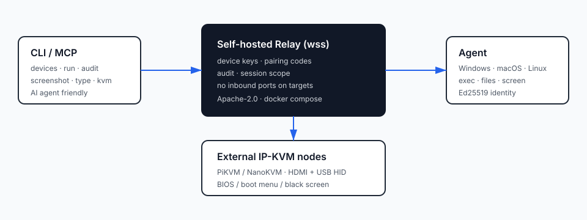

# U-Link Core

[](https://github.com/dongsheng123132/u-link-core/actions/workflows/ci.yml)
[](LICENSE)
[](https://go.dev/)
[中文文档](README.zh-CN.md) · [CLI 文档](docs/ULINK-CLI.md) · [KVM 适配器](docs/KVM-ADAPTER.md)

> **Self-hosted, CLI/MCP-first remote execution for your own machines** — or for
> employees who explicitly consented. No inbound ports, no account, no cloud
> dependency, and no screen recording by default.

[中文版 README](README.zh-CN.md)

U-Link Core is the open-source core of the U-Link family. An operator — or an AI
agent — can run commands, move files, look at the screen, audit every action,
and even reach a machine that never booted, using a relay **you host yourself**.

The MCP server uses stdio and runs as the local user. Its tools call the same
CLI operations and authenticate to the relay with the locally configured
controller token; any AI client that can start this process can exercise that
user's U-Link permissions. Keep the token in a private config file or secret
store, and only register trusted AI clients.

- **Not** a remote desktop (MeshCentral / RustDesk territory).
- **Not** for controlling customers without consent.
- **Not** a public relay service.

---

## Architecture



```
[ CLI / MCP ]  --wss-->  [ self-hosted relay ]  <--wss--  [ agent on each machine ]
 ulink                device keys · pairing           Windows · macOS · Linux
 devices/run/audit    session scope · audit            exec · files · screen
```

Targets never open an inbound port: agents dial out to your relay.

## Quick start

### 1. Run a relay (your own Linux box, or an internal server)

```bash
cd deploy/relay
cp .env.example .env      # set AGENT_TOKEN / CONTROLLER_TOKEN
mkdir -p tls && openssl req -x509 -newkey rsa:2048 -nodes -days 365 \
  -keyout tls/key.pem -out tls/cert.pem -subj "/CN=relay.example.com" \
  -addext "subjectAltName=DNS:relay.example.com" # replace with your relay hostname
# Share this fingerprint with clients over a trusted channel.
openssl x509 -in tls/cert.pem -noout -fingerprint -sha256
docker compose up -d --build
curl -k https://127.0.0.1:8900/health    # ok
```

### 2. Start an agent on a machine you own

```bash
./ulink-agent --server wss://relay.example.com:8900 --token "$AGENT_TOKEN" \
  --id my-pc --file-roots "$HOME"
```

For a self-signed relay, set `ULINK_TLS_PIN` to the SHA-256 fingerprint from
`openssl x509` on **both** the agent and controller. Distribute the fingerprint
out of band over a trusted channel. With a publicly trusted TLS certificate, no
pin is needed; clients use normal certificate and hostname verification.

Pin mode still checks that the certificate is valid for the host you dialed, so
the certificate must cover the address your clients use. When you reach the
relay by IP, add an IP SAN, for example
`-addext "subjectAltName=IP:192.168.1.5"`.

The agent prints a **6-digit enrollment code** and waits for approval:

```
Enrollment code: 381385 (waiting for IT approval)
```

### 3. Approve it from the operator side

```bash
ulink --relay wss://relay.example.com:8900 --token "$CONTROLLER_TOKEN" pair approve 381385
ulink devices
```

### 4. Operate

```bash
ulink --json run my-pc -- hostname          # run a command
ulink screenshot my-pc --out shot.png       # look at the screen
ulink audit --limit 20                      # what happened
ulink mcp                                   # expose to Claude Code / DSH / Codex
```

## What the CLI gives you

| Command | What it does |
|---|---|
| `ulink devices` | list online devices (with public-key fingerprint) |
| `ulink run <dev> -- <cmd>` | run a command; `--json` for agents; exit code = remote exit code |
| `ulink screenshot <dev>` | capture one frame on the device and pull it back |
| `ulink type <dev> --text "..."` | paste text into the focused window (experimental) |
| `ulink audit` | local JSONL audit trail of every remote action |
| `ulink pair init/issue/approve/revoke` | device identity, one-time codes, revocation |
| `ulink kvm shot/key/type` | drive external IP-KVM nodes (PiKVM / NanoKVM) — see [docs/KVM-ADAPTER.md](docs/KVM-ADAPTER.md) |
| `ulink mcp` | MCP stdio server: `ulink_devices`, `ulink_run`, `ulink_audit` |

## Security defaults

- **Device identity**: every device holds an Ed25519 key; the relay binds
  `device id → public key` and rejects a different key for the same id.
- **Consent**: a new device needs a one-time 6-digit code that an operator
  approves (`ulink pair approve <code>`). Codes expire and are rate-limited.
- **Least privilege**: push/pull is confined to `--file-roots` (default: home + temp).
- **Audit + redaction**: commands are recorded locally and secret-looking values
  are masked in logs.
- **TLS pinning**: `--tls-pin` / `ULINK_TLS_PIN` pins the relay certificate.
- **Path safety**: results are routed to the device that was asked, so a
  compromised agent cannot inject output into another machine's session.

Read [SECURITY.md](SECURITY.md) before exposing a relay to the internet.

## Status

**v0.3 alpha.** The core is usable self-hosted and is being hardened. Known
gaps: the controller token is still a single global token, payload E2E is not
implemented, and there is no Windows admin helper yet.

## Verify locally

```bash
go test ./...
./scripts/e2e-test.sh
```

The end-to-end smoke test starts a local relay, enrolls and approves one agent,
executes one command, and revokes the device. It does not contact a hosted relay.

## Contributing

Issues and PRs are welcome — see [CONTRIBUTING.md](CONTRIBUTING.md). Good first
contributions: a new recipe, a new KVM backend, a Windows/macOS fix, or docs
in your language.

## License

Apache License 2.0 — [LICENSE](LICENSE) · [NOTICE](NOTICE).

The private **U-Link Enterprise** edition adds a central console, RBAC/SSO,
multi-tenant MSP support, a Windows admin helper, policy/approval flows, audit
export to SIEM, signed installers, and support. The core stays Apache-2.0.
