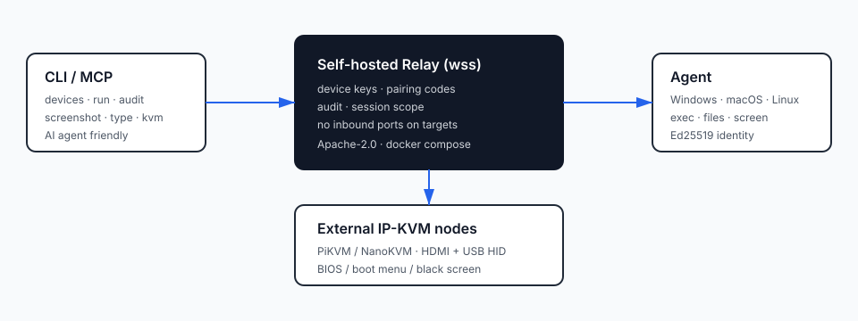

# U-Link Core

[](https://github.com/dongsheng123132/u-link-core/actions/workflows/ci.yml)
[](LICENSE)
[](https://go.dev/)
[English](README.md) · [CLI 文档](docs/ULINK-CLI.md) · [KVM 适配器](docs/KVM-ADAPTER.md)

> **给自己机器用的、自托管、CLI/MCP 优先的远程执行层**：无入站端口、无账号、不依赖云，默认不录屏。

U-Link Core 是 U-Link 家族的开源核心。运维人员——或者 AI agent——可以用**自己托管的 relay**
在跨 NAT 的机器上跑命令、传文件、看屏幕、审计每一步，甚至够到一台还没进操作系统的机器。

MCP 服务通过 stdio 启动，权限等同于运行它的本机用户。MCP 工具调用与 CLI 共用操作路径，并用本机配置的 controller token 连接 relay；任何能启动该进程的 AI 客户端，都能使用这个用户在 U-Link 上的权限。请把 token 放在仅本人可读的配置或密钥库中，只接入可信的 AI 客户端。

- **不是**远程桌面（那是 MeshCentral / RustDesk 的地盘）。
- **不是**用来在未经同意的情况下控制客户机器。
- **不是**公共 relay 服务。

## 桌面版（macOS 菜单栏 / Windows 托盘）

`cmd/link` 把同一套 relay / agent / controller 做成常驻桌面应用：一个状态点看在线没在线，
点开是本地控制台（设备列表 + 流式终端），配对一次即可互控。

```bash
make link                 # macOS 菜单栏程序（需要 cgo）
make link-windows         # Windows 托盘程序
make link-package-mac     # 打包 build/U-Link.app + zip
```

桌面版**首次运行是未配置状态**：在控制台「设置」里填自己的 relay 地址、被控端令牌和控制端令牌。
完整说明（构建、首次配置、安全注意、卸载）见 [docs/DESKTOP-APP.md](docs/DESKTOP-APP.md)。

## 架构



```
[ CLI / MCP ]  --wss-->  [ 自托管 relay ]  <--wss--  [ 每台机器上的 agent ]
 ulink                设备密钥 · 配对码              Windows · macOS · Linux
 devices/run/audit    会话范围 · 审计                exec · 文件 · 屏幕
```

目标机器**永远不用开入站端口**：agent 主动向外连你的 relay。

## 快速开始

### 1. 起一个 relay（自己的 Linux 机器或内网服务器）

```bash
cd deploy/relay
cp .env.example .env      # 填 AGENT_TOKEN / CONTROLLER_TOKEN
mkdir -p tls && openssl req -x509 -newkey rsa:2048 -nodes -days 365 \
  -keyout tls/key.pem -out tls/cert.pem -subj "/CN=relay.example.com" \
  -addext "subjectAltName=DNS:relay.example.com" # 替换成你的 relay 域名
# 把指纹通过可信渠道交给客户端
openssl x509 -in tls/cert.pem -noout -fingerprint -sha256
docker compose up -d --build
curl -k https://127.0.0.1:8900/health    # ok
```

### 2. 在自己的机器上起 agent

```bash
./ulink-agent --server wss://relay.example.com:8900 --token "$AGENT_TOKEN" \
  --id my-pc --file-roots "$HOME"
```

自签名 relay 需要在**被控端和控制端**都设置 `ULINK_TLS_PIN`，值为 `openssl x509` 输出的 SHA-256 证书指纹，并通过可信的带外渠道分发指纹。使用受信任 CA 签发的证书时无需 pin，客户端默认执行系统证书链和主机名校验。

pin 模式仍会校验证书对「实际拨号的地址」是否有效，所以证书必须覆盖客户端使用的地址。用 IP 访问 relay 时，要在证书里加 IP SAN，例如
`-addext "subjectAltName=IP:192.168.1.5"`。

agent 会打印 **6 位验证码**并等待审批：

```
Enrollment code: 381385 (waiting for IT approval)
```

### 3. 在控制端审批

```bash
ulink --relay wss://relay.example.com:8900 --token "$CONTROLLER_TOKEN" pair approve 381385
ulink devices
```

### 4. 开始干活

```bash
ulink --json run my-pc -- hostname          # 跑命令
ulink screenshot my-pc --out shot.png       # 看屏幕
ulink audit --limit 20                      # 发生过什么
ulink mcp                                   # 接到 Claude Code / DSH / Codex
```

## 命令一览

| 命令 | 作用 |
|---|---|
| `ulink devices` | 列出在线设备（带公钥指纹） |
| `ulink run <dev> -- <cmd>` | 执行命令；`--json` 给 agent 用；退出码=远端退出码 |
| `ulink screenshot <dev>` | 远端截一屏并拉回本地 |
| `ulink type <dev> --text "..."` | 往远端焦点窗口粘贴（实验性） |
| `ulink audit` | 本地 JSONL 审计流水 |
| `ulink pair init/issue/approve/revoke` | 设备身份、一次性码、吊销 |
| `ulink kvm shot/key/type` | 驱动外置 IP-KVM（PiKVM / NanoKVM），见 [docs/KVM-ADAPTER.md](docs/KVM-ADAPTER.md) |
| `ulink mcp` | MCP stdio server：`ulink_devices` / `ulink_run` / `ulink_audit` |

## 默认安全措施

- **设备身份**：每台机器一把 Ed25519 密钥；relay 把 `设备 ID → 公钥` 绑定，同 ID 换钥匙直接拒绝。
- **员工同意**：新设备必须有一枚一次性 6 位码，由运维审批（`ulink pair approve`）；码会过期、有限流。
- **最小权限**：push/pull 锁定在 `--file-roots`（默认 home + 临时目录）。
- **审计与脱敏**：命令进本地审计文件，日志里的疑似凭据会被打码。
- **TLS pin**：`--tls-pin` / `ULINK_TLS_PIN` 固定 relay 证书指纹。
- **结果不串台**：结果按请求的设备回传，被攻陷的 agent 无法把输出注入别的机器的会话。

把 relay 暴露到公网前，请先读 [SECURITY.md](SECURITY.md)。

## 状态

**v0.3 alpha**：核心可自托管使用，仍在加固中。已知缺口：controller token 仍是全局单 token、
没有端到端加密、还没有 Windows 管理员 Helper。

## 本地验证

```bash
go test ./...
./scripts/e2e-test.sh
```

端到端冒烟会在本机启动 relay，完成一个 agent 的注册、审批、命令执行和设备吊销；不会连接任何托管 relay。

## 参与共建

欢迎提 issue 和 PR，见 [CONTRIBUTING.md](CONTRIBUTING.md)。最容易上手的贡献：加一条 recipe、
加一个 KVM 后端、修一个 Windows/macOS 问题，或者补一份你母语的文档。

## 许可证

Apache License 2.0 —— [LICENSE](LICENSE) · [NOTICE](NOTICE)。

私有版 **U-Link Enterprise** 提供中央控制台、RBAC/SSO、MSP 多租户、Windows 管理员 Helper、
策略与审批流、审计外发到 SIEM、签名安装包与技术支持；核心保持 Apache-2.0。
